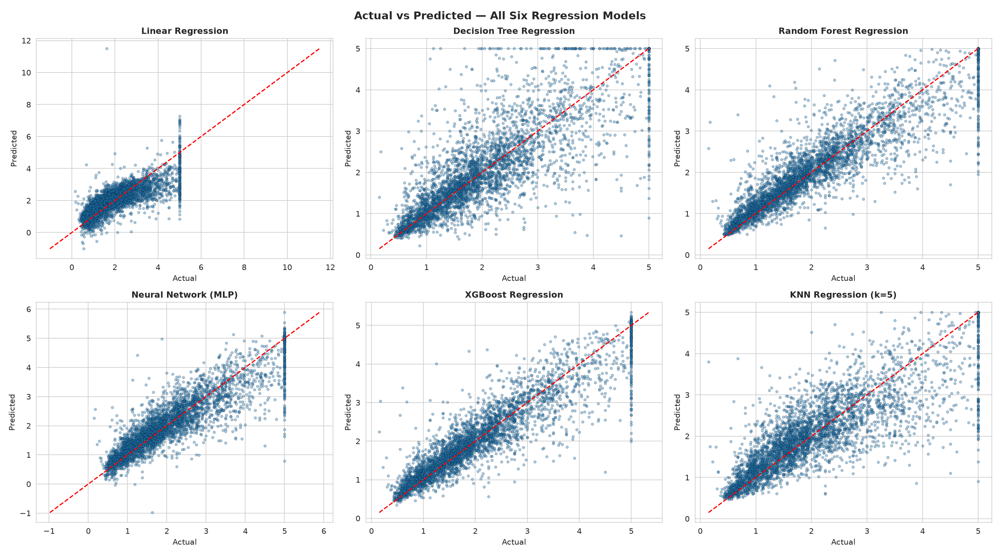
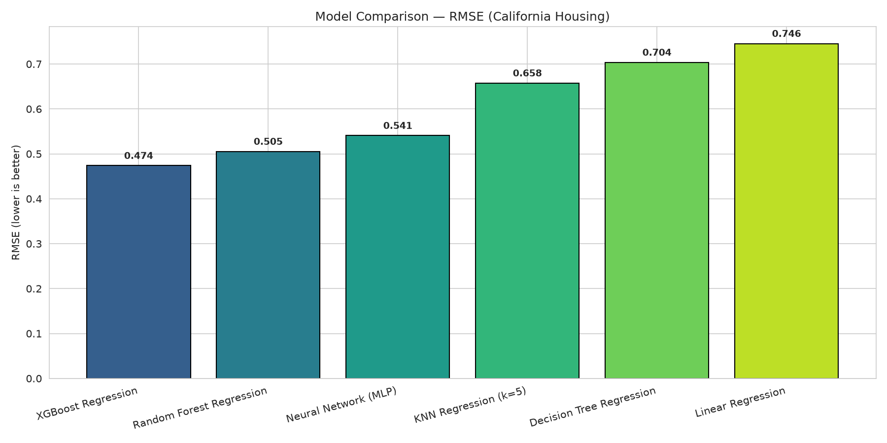
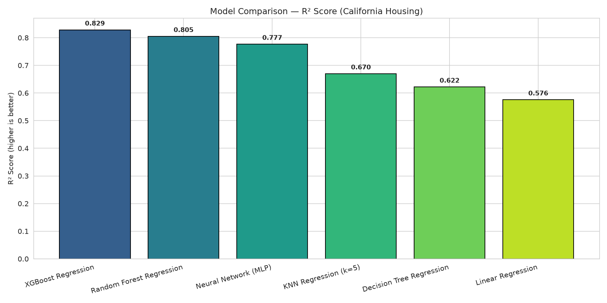

# Comparative Implementation of Machine Learning Regression Algorithms

**Student:** Muhammad Ahsan Khan (FA23-BAI-052)
**Assignment:** Comparative Implementation of Machine Learning Regression Algorithms (Handwritten + Programming)
**Repository:** `ahsankhank1666-gif/BAI-07-COMPUTER-VISION`
**Folder:** `Assignment_Regression_Comparison/`

---

## 1. Objective

Implement and compare **six regression algorithms** on the **same dataset**, with the **same features, same target, and the same 80:20 train/test split**, and evaluate them using **MAE, MSE, RMSE, and R² Score**.

### Algorithms (2 implementations each)
1. Linear Regression
2. Decision Tree Regression
3. Random Forest Regression
4. Neural Network Regression (MLP)
5. XGBoost Regression
6. K-Nearest Neighbors Regression (KNN)

> **Note on the Handwritten part:** The handwritten derivations / step-by-step calculations are uploaded separately in `handwritten_notes/`. This folder contains the full Python implementation, results, and analysis.

---

## 2. Dataset: California Housing (House Price Prediction)

The **California Housing** dataset (built into scikit-learn) was chosen as the house-price regression benchmark.

- **Samples:** 20,640
- **Features (8):** `MedInc`, `HouseAge`, `AveRooms`, `AveBedrms`, `Population`, `AveOccup`, `Latitude`, `Longitude`
- **Target:** `MedHouseValue` (median house value in units of $100,000)
- **Missing values:** None
- **Source:** `sklearn.datasets.fetch_california_housing` (based on the 1990 US Census)

### Why this dataset?
- Real-world house-price prediction benchmark.
- Mix of linear and non-linear feature relationships — ideal for comparing simple vs. ensemble/neural models.
- Clean (no missing values) but still realistic and large enough for fair 80:20 evaluation.

---

## 3. Methodology

1. Load dataset into a pandas DataFrame.
2. Check for missing values (none found).
3. Split **80% train / 20% test** with `random_state=42` (same split for all 6 models).
4. **Feature scaling:** `StandardScaler` fitted **only on training data** (no leakage).
   - Used by: Linear Regression, Neural Network (MLP), KNN
   - Not required by tree-based models: Decision Tree, Random Forest, XGBoost
5. Train all six models and predict on the test set.
6. Evaluate with **MAE, MSE, RMSE, R²**.
7. Save comparative table and plots to `results/`.

---

## 4. Python Implementation

Main script: **`regression_comparison.py`**

```bash
pip install -r requirements.txt
python regression_comparison.py
```

The script:
- Loads the California Housing dataset
- Performs the 80:20 split (`random_state=42`)
- Scales features where required
- Trains all six models
- Prints and saves the metrics table (`results/metrics_comparison.csv`)
- Generates all plots

---

## 5. Results

### 5.1 Comparative Performance Table (sorted by RMSE ↓)

| Rank | Algorithm | MAE | MSE | RMSE | R² Score |
|:----:|-----------|----:|----:|-----:|---------:|
| 1 | **XGBoost Regression** | 0.3156 | 0.2245 | **0.4739** | **0.8287** |
| 2 | Random Forest Regression | 0.3275 | 0.2554 | 0.5053 | 0.8051 |
| 3 | Neural Network (MLP) | 0.3688 | 0.2924 | 0.5407 | 0.7769 |
| 4 | KNN Regression (k=5) | 0.4462 | 0.4324 | 0.6576 | 0.6700 |
| 5 | Decision Tree Regression | 0.4547 | 0.4952 | 0.7037 | 0.6221 |
| 6 | Linear Regression | 0.5332 | 0.5559 | 0.7456 | 0.5758 |

> Target unit: $100,000. So an RMSE of ≈ 0.474 ≈ **$47,400 average prediction error**.

Raw CSV: [`results/metrics_comparison.csv`](results/metrics_comparison.csv)

### 5.2 Actual vs Predicted — all six models



Individual plots:
- [Linear Regression](results/actual_vs_predicted_Linear_Regression.png)
- [Decision Tree Regression](results/actual_vs_predicted_Decision_Tree_Regression.png)
- [Random Forest Regression](results/actual_vs_predicted_Random_Forest_Regression.png)
- [Neural Network (MLP)](results/actual_vs_predicted_Neural_Network_MLP.png)
- [XGBoost Regression](results/actual_vs_predicted_XGBoost_Regression.png)
- [KNN Regression (k=5)](results/actual_vs_predicted_KNN_Regression_k5.png)

### 5.3 Error comparison charts





---

## 6. Strengths & Limitations of Each Algorithm

### 6.1 Linear Regression
**Strengths**
- Simple, fast, highly interpretable (coefficients directly show feature impact).
- Works well when the relationship is (close to) linear.
- Low variance; good baseline.

**Limitations**
- Cannot capture non-linear relationships.
- Sensitive to outliers and multicollinearity.
- Assumes linearity, independence, homoscedasticity, and normally distributed residuals.

**Observed:** Worst RMSE (0.7456) and lowest R² (0.5758) — the housing data is strongly non-linear (e.g., location effects, income vs. price curve), so a plain linear model underfits.

---

### 6.2 Decision Tree Regression
**Strengths**
- Captures non-linear relationships and feature interactions automatically.
- No need for feature scaling.
- Interpretable rules (feature thresholds).
- Handles mixed data types.

**Limitations**
- High variance — prone to overfitting (deep trees memorize training data).
- Unstable: small data changes can produce very different trees.
- Piecewise-constant predictions.

**Observed:** Better than Linear (R² 0.6221) but still weak — a single unpruned tree (`max_depth=None`) overfits and generalizes poorly.

---

### 6.3 Random Forest Regression
**Strengths**
- Reduces variance via bagging (averaging many decorrelated trees).
- Robust to outliers and noise; strong out-of-the-box performance.
- No feature scaling required.
- Provides feature importance.

**Limitations**
- Less interpretable than a single tree.
- Slower / heavier (100 trees).
- Can still miss very fine-grained patterns; predictions are averages of trees (limited extrapolation).

**Observed:** 2nd best — RMSE 0.5053, R² 0.8051. Ensemble averaging clearly beats a single tree.

---

### 6.4 Neural Network Regression (MLPRegressor)
**Strengths**
- Universal function approximator — models complex non-linear patterns.
- With enough data/neurons can learn very rich representations.
- Flexible architecture (hidden layers, activations, optimizers).

**Limitations**
- Needs feature scaling and careful tuning (layers, LR, epochs).
- Black-box (low interpretability).
- Can overfit and is sensitive to hyperparameters & random seed.
- Slower to train; needs enough data.

**Observed:** Solid middle — RMSE 0.5407, R² 0.7769. Single hidden layer (100, relu, Adam, max_iter=500) performed competitively but below the tree ensembles.

---

### 6.5 XGBoost Regression ⭐ (Best)
**Strengths**
- Gradient boosting builds trees **sequentially**, each correcting previous errors.
- Regularization (L1/L2) reduces overfitting.
- Very strong on tabular data; handles non-linearity & interactions well.
- No feature scaling needed; fast histogram-based training.

**Limitations**
- More hyperparameters to tune (`n_estimators`, `learning_rate`, `max_depth`, …).
- Less interpretable than linear/tree models.
- Can overfit if learning rate is high / trees too deep without regularization.

**Observed:** **Best overall** — RMSE **0.4739**, R² **0.8287**, lowest MAE (0.3156). Winner on this tabular house-price task.

---

### 6.6 K-Nearest Neighbors Regression (KNN, k=5)
**Strengths**
- Simple, intuitive ("predict the average of the k nearest houses").
- No training phase (lazy learner); captures local patterns.
- Non-parametric, no strong assumptions about the data distribution.

**Limitations**
- Requires feature scaling (distance-based).
- Slow at prediction time (computes distances to all training points).
- Sensitive to choice of `k`, noise, and curse of dimensionality.
- Struggles to extrapolate beyond the training range.

**Observed:** Mid-pack — RMSE 0.6576, R² 0.6700. Works reasonably but distances in 8-D feature space are noisy.

---

## 7. Conclusion & Justification

**Best-performing algorithm: XGBoost Regression**

| Metric | XGBoost | Random Forest | Improvement vs RF |
|--------|--------:|--------------:|------------------:|
| MAE | 0.3156 | 0.3275 | −3.6% |
| MSE | 0.2245 | 0.2554 | −12.1% |
| RMSE | 0.4739 | 0.5053 | −6.2% |
| R² | 0.8287 | 0.8051 | +2.4% |

**Why XGBoost won**
1. The California Housing target is a **non-linear function** of location (Latitude/Longitude), income, and occupancy — tree ensembles capture these interactions natively.
2. Boosting **focuses successive trees on residual errors**, which fits the skewed, heavy-tailed house-price distribution better than bagging (RF) or a single tree (DT).
3. **Built-in regularization** keeps variance under control — unlike the unconstrained Decision Tree.
4. Linear Regression underfits (no non-linear terms); KNN suffers from noisy distances in 8 dimensions; the MLP needs more tuning/data to match the ensembles.

**Overall ranking (by RMSE, lower is better):**
**XGBoost < Random Forest < Neural Network (MLP) < KNN < Decision Tree < Linear Regression**

**Practical takeaway:** For tabular house-price prediction with this feature set, **gradient-boosted trees (XGBoost) are the recommended model**. Random Forest is a strong, easier-to-tune runner-up. If interpretability is mandatory, Linear Regression is the transparent baseline (at a clear accuracy cost).

---

## 8. Files in this folder

```
Assignment_Regression_Comparison/
├── README.md                          ← this file (full report & analysis)
├── regression_comparison.py           ← main implementation (all 6 models)
├── requirements.txt                   ← Python dependencies
├── results/
│   ├── metrics_comparison.csv         ← raw metrics table
│   ├── metrics_comparison.png         ← RMSE bar chart
│   ├── r2_comparison.png              ← R² bar chart
│   ├── actual_vs_predicted_all.png    ← 2×3 grid of all models
│   ├── actual_vs_predicted_Linear_Regression.png
│   ├── actual_vs_predicted_Decision_Tree_Regression.png
│   ├── actual_vs_predicted_Random_Forest_Regression.png
│   ├── actual_vs_predicted_Neural_Network_MLP.png
│   ├── actual_vs_predicted_XGBoost_Regression.png
│   └── actual_vs_predicted_KNN_Regression_k5.png
└── handwritten_notes/
    └── README.md                      ← placeholder for handwritten part (to be uploaded)
```

## 9. Handwritten Component

The assignment requires **handwritten** working-procedure + mathematical equations + step-by-step worked solution on a small data sample for each algorithm. That part is **uploaded separately** in the `handwritten_notes/` folder (and will be added once scanned). The Python implementation above is the complete programming counterpart to those notes.

---

### Reproducibility
- Python 3.13, scikit-learn 1.6.1, xgboost 3.4.1, pandas 2.2.3, numpy 2.3.5
- `random_state=42` everywhere; train/test split 80/20
- Scaler fit on train only (no data leakage)
