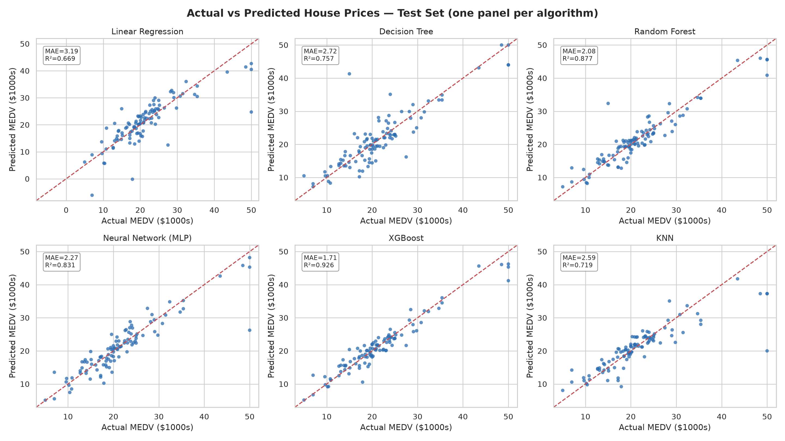
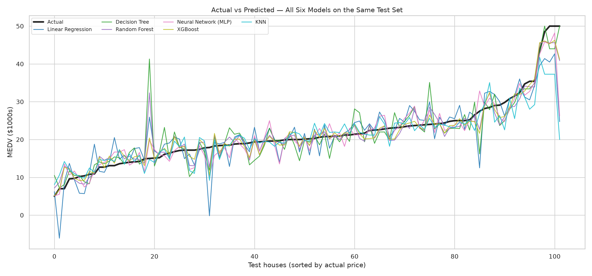
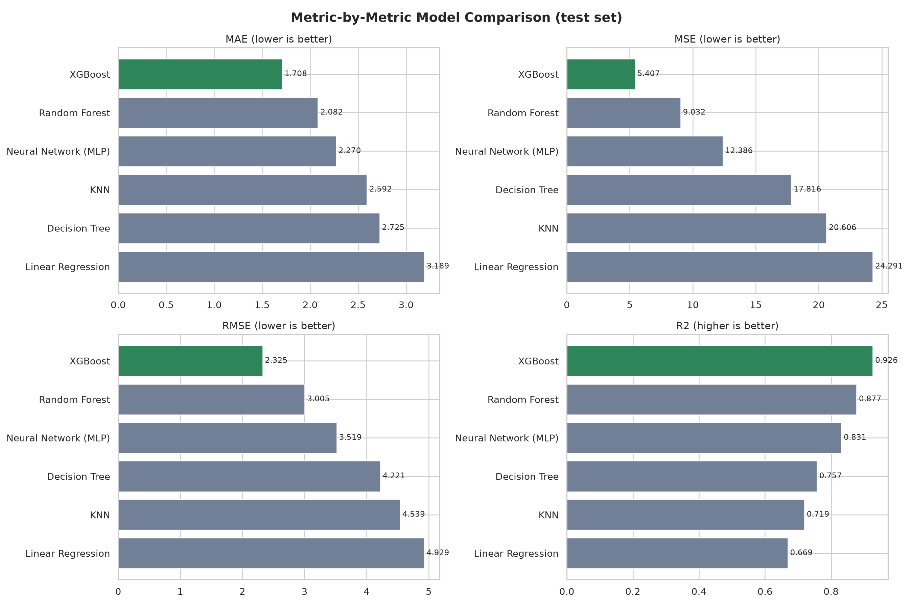
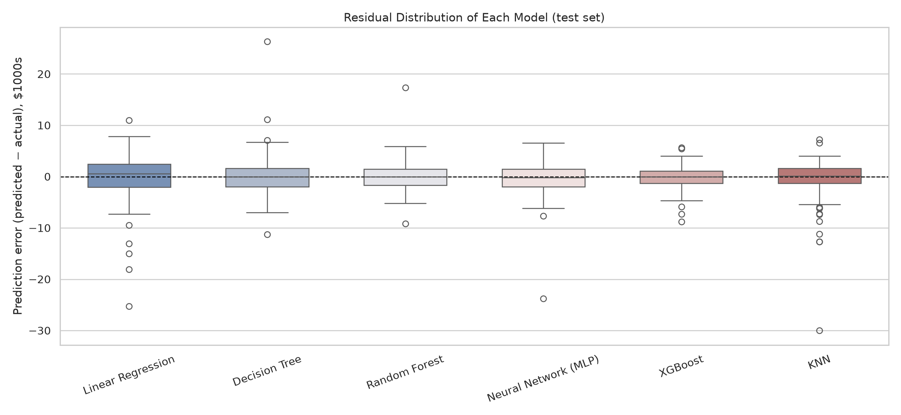

# Comparative Implementation of Machine Learning Regression Algorithms

> **Course:** BAI-07 Computer Vision  
> **Student:** Muhammad Ahsan Khan — FA23-BAI-052  
> **Assignment:** Comparative Implementation of Machine Learning Regression Algorithms (Handwritten + Programming)  
> **Problem:** House price prediction — estimate the median value of owner-occupied homes (`MEDV`) from 13 neighbourhood attributes.

---

## 1. What is in this folder?

The **same** regression problem is solved six times — once with each algorithm — under strictly identical conditions (dataset, features, target, 80:20 split, preprocessing, metrics). Both parts of the assignment are included:

| Part | Deliverable | File |
|---|---|---|
| Programming | Fully runnable comparison pipeline (6 models + 4 metrics + plots) | [`regression_comparison.py`](regression_comparison.py) |
| Programming | Executed results: metric tables, per-house predictions, figures, logs | [`results/`](results/) |
| Handwritten | Working procedure, equations, and by-hand sample calculations for all six algorithms | [`HANDWRITTEN_IMPLEMENTATIONS.md`](HANDWRITTEN_IMPLEMENTATIONS.md) |
| Handwritten | Machine-checked arithmetic for the small sample (generated script) | [`handwritten_demo.py`](handwritten_demo.py) → [`results/handwritten_step_by_step.txt`](results/handwritten_step_by_step.txt) |
| Report | Comparative discussion, strengths/limitations, and justified best model | [`RESULTS_REPORT.md`](RESULTS_REPORT.md) |

---

## 2. Folder structure

```text
Comparative Implementation of Machine Learning Regression Algorithms/
├── README.md                         # This file - setup, method, results
├── requirements.txt                  # Python dependencies
├── regression_comparison.py          # Main pipeline: train, evaluate, export
├── handwritten_demo.py               # Step-by-step arithmetic on a small sample
├── HANDWRITTEN_IMPLEMENTATIONS.md    # Theory, equations, worked examples
├── RESULTS_REPORT.md                 # Full experimental report & conclusion
├── data/
│   └── boston_housing.csv            # Real regression dataset (506 rows, 13 features + target)
└── results/                          # GENERATED OUTPUTS (committed, ready to view)
    ├── performance_metrics.csv       # Raw numbers for all 6 models (train + test)
    ├── performance_table.md          # Formatted comparative performance table
    ├── predictions_all_models.csv    # Actual vs predicted for all 102 test houses
    ├── model_configuration.json      # Exact hyperparameters, split, seeds, versions
    ├── handwritten_step_by_step.txt  # Calculated by-hand demonstration log
    ├── run_log.txt                   # Console output of the actual experiment run
    ├── actual_vs_predicted_grid.png  # 2x3 scatter: actual vs predicted per model
    ├── actual_vs_predicted_all_models.png  # Overlaid curves for all 6 models
    ├── metrics_comparison.png        # Bar charts for MAE / MSE / RMSE / R²
    └── residual_distribution.png     # Box plots of prediction errors
```

---

## 3. Dataset

- **File:** [`data/boston_housing.csv`](data/boston_housing.csv) — 506 rows, 14 columns.
- **Source:** [`selva86/datasets/BostonHousing.csv`](https://github.com/selva86/datasets/blob/master/BostonHousing.csv) (the classic Boston housing regression benchmark, distributed with the dataset collection used by R's `MASS` library).
- **Target (`y`):** `medv` — median value of owner-occupied homes, in **$1000s**.
- **Input features (`X`, all 13):** `crim, zn, indus, chas, nox, rm, age, dis, rad, tax, ptratio, b, lstat`.
- No missing values; all columns are numeric. Target range in the dataset: **5.0 – 50.0**.

> The dataset is bundled in the repository so the experiment is fully reproducible offline — no Kaggle key or internet access is required to rerun it.

---

## 4. Setup and run

```bash
# 1. Install the dependencies
pip install -r requirements.txt

# 2. Run the six-algorithm comparison (regenerates everything in results/)
python regression_comparison.py

# 3. Regenerate the by-hand calculation log
python handwritten_demo.py
```

Optional arguments for the main script:

```bash
python regression_comparison.py --data data/boston_housing.csv --results results --seed 42
```

The scripts resolve paths relative to themselves, so they also work when launched from another directory.

**Verified environment:** Python 3.11.2 · NumPy 2.4.6 · pandas 3.1.1 · scikit-learn 1.9.1 · XGBoost 3.2.0 · Matplotlib 3.11.2 · Seaborn 0.13.2 (exact versions are also stored in `results/model_configuration.json`).

---

## 5. Experimental protocol (fair comparison)

| Item | Value (identical for all six algorithms) |
|---|---|
| Dataset | `boston_housing.csv`, all 506 rows |
| Features | All 13 numeric predictors |
| Target | `medv` |
| Split | `train_test_split(test_size=0.20, random_state=42, shuffle=True)` → **404 train / 102 test** |
| Preprocessing | `StandardScaler` fitted on the **training partition only**, inside each `Pipeline` (no data leakage) |
| Test-set use | Held out; used only once for the final evaluation |
| Hyperparameters | Fixed a priori (no tuning on the test set); all random seeds = 42 |
| Metrics | MAE, MSE, RMSE, R² — computed on the same 102 test houses |

Models compared:

| # | Algorithm | Implementation / key settings |
|---:|---|---|
| 1 | Linear Regression | `LinearRegression()` — closed-form least squares |
| 2 | Decision Tree Regression | `DecisionTreeRegressor(random_state=42)`, CART squared-error criterion |
| 3 | Random Forest Regression | `RandomForestRegressor(n_estimators=300, random_state=42)` |
| 4 | Neural Network Regression | `MLPRegressor(hidden_layer_sizes=(64,32), activation='relu', solver='adam', alpha=1e-4, max_iter=3000, random_state=42)` — converged in 314 iterations |
| 5 | XGBoost Regression | `XGBRegressor(n_estimators=400, learning_rate=0.05, max_depth=3, subsample=0.9, colsample_bytree=0.9, reg_lambda=1, random_state=42)` |
| 6 | KNN Regression | `KNeighborsRegressor(n_neighbors=5, p=2)` — Euclidean distance |

> Standardisation is applied uniformly to all six pipelines. Tree-based splits are invariant to positive affine scaling, so this does not favour or penalise any model; KNN and the MLP genuinely require it.

---

## 6. Results (test set, 20% hold-out)

Full details: [`RESULTS_REPORT.md`](RESULTS_REPORT.md), [`results/performance_metrics.csv`](results/performance_metrics.csv).

| Rank | Model | MAE ↓ | MSE ↓ | RMSE ↓ | R² ↑ | Train R² | Fit time (s) |
|---:|---|---:|---:|---:|---:|---:|---:|
| 1 | **XGBoost** | **1.7081** | **5.4074** | **2.3254** | **0.9263** | 0.9886 | 0.085 |
| 2 | Random Forest | 2.0822 | 9.0315 | 3.0052 | 0.8768 | 0.9780 | 0.457 |
| 3 | Neural Network (MLP) | 2.2701 | 12.3856 | 3.5193 | 0.8311 | 0.8792 | 0.493 |
| 4 | Decision Tree | 2.7245 | 17.8156 | 4.2209 | 0.7571 | 1.0000 | 0.005 |
| 5 | KNN | 2.5922 | 20.6055 | 4.5393 | 0.7190 | 0.8499 | 0.003 |
| 6 | Linear Regression | 3.1891 | 24.2911 | 4.9286 | 0.6688 | 0.7509 | 0.015 |

**Best model: XGBoost Regression.** It has the lowest error on **all four** metrics (RMSE 2.33 vs 3.01 for the runner-up) and explains 92.6% of the variance in unseen house prices. See the justification in [`RESULTS_REPORT.md`](RESULTS_REPORT.md) §7.

### Visualizations









---

## 7. How the handwritten part connects to the code

[`HANDWRITTEN_IMPLEMENTATIONS.md`](HANDWRITTEN_IMPLEMENTATIONS.md) gives, for every algorithm, (a) the working procedure, (b) the governing equations, and (c) a fully worked numerical example on a small sample of the **same** dataset (the first 3–5 houses). Running `handwritten_demo.py` recomputes those numbers from the CSV — for example:

- Linear regression: `S_xy = 5.635`, `S_xx = 0.3265` → `b₁ = 17.25859`, `b₀ = -89.33190`.
- Decision tree: parent MSE `32.5719`, weighted child MSE `0.9313`, variance gain `31.6406`.
- XGBoost: base score `28.425`, first leaf values `+1.70625` / `-3.41250`, one boosting update.
- KNN: the three nearest neighbours of house H1 predict `34.7667` (actual `24.0`).

The complete arithmetic, including all intermediate products and distances, is in [`results/handwritten_step_by_step.txt`](results/handwritten_step_by_step.txt).

---

## 8. References

1. James, G., Witten, D., Hastie, T., & Tibshirani, R. (2013). *An Introduction to Statistical Learning*. Springer.
2. Breiman, L. (1996). Bagging predictors. *Machine Learning*, 24, 123–140.
3. Breiman, L. (2001). Random forests. *Machine Learning*, 45, 5–32.
4. Chen, T., & Guestrin, C. (2016). XGBoost: A scalable tree boosting system. *KDD*, 785–794.
5. Rumelhart, D., Hinton, G., & Williams, R. (1986). Learning representations by back-propagating errors. *Nature*, 323, 533–536.
6. Cover, T., & Hart, P. (1967). Nearest neighbor pattern classification. *IEEE Trans. Information Theory*, 13(1), 21–27.
7. Scikit-learn developers. *API documentation* — <https://scikit-learn.org/stable/>; XGBoost documentation — <https://xgboost.readthedocs.io/>.
