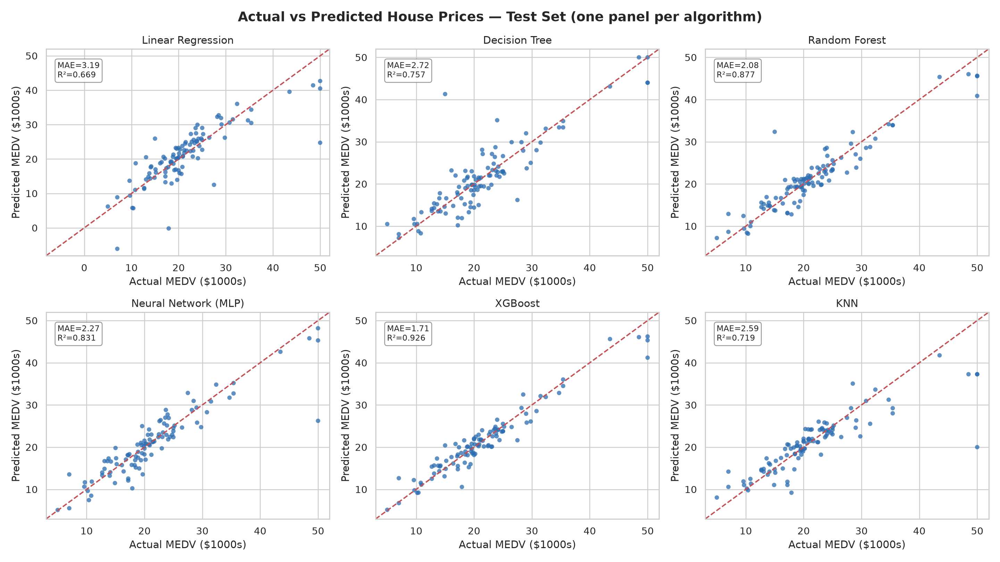
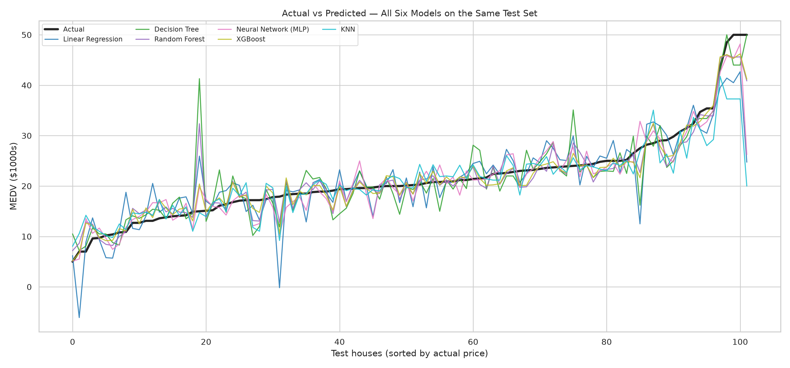
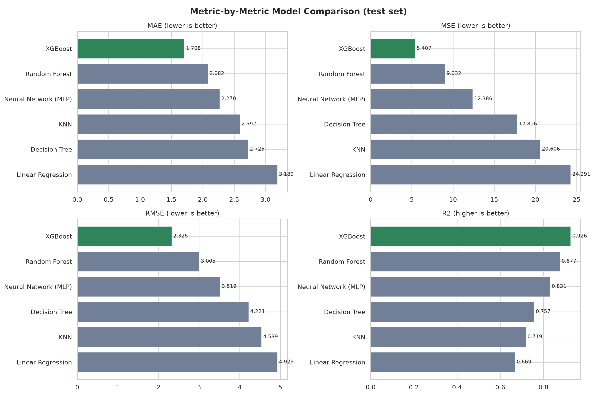
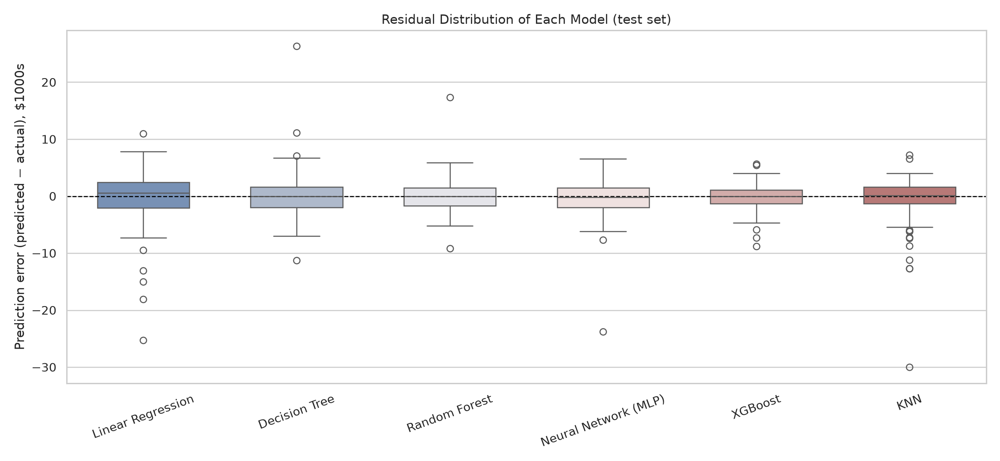

# Experimental Results Report — Comparative Regression Algorithms

**Course:** BAI-07 Computer Vision  
**Student:** Muhammad Ahsan Khan — FA23-BAI-052  
**Date:** 19 November 2026  
**Problem:** Predict median house value (`MEDV`, in $1000s) from 13 neighbourhood features.

---

## 1. Objective

Solve **one** regression problem with six different algorithms — Linear Regression, Decision Tree,
Random Forest, Neural Network (MLP), XGBoost and KNN — under identical data and evaluation
conditions, compare them with MAE, MSE, RMSE and R², visualise the predictions, discuss each
method's strengths/limitations, and identify the best-performing model with evidence.

The handwritten theory, equations and small-sample calculations are in
[`HANDWRITTEN_IMPLEMENTATIONS.md`](HANDWRITTEN_IMPLEMENTATIONS.md).

---

## 2. Experimental setup

| Item | Setting |
|---|---|
| Dataset | [`data/boston_housing.csv`](data/boston_housing.csv) — 506 rows, 13 numeric predictors + `medv` |
| Source | [`selva86/datasets/BostonHousing.csv`](https://github.com/selva86/datasets/blob/master/BostonHousing.csv) |
| Input features | `crim, zn, indus, chas, nox, rm, age, dis, rad, tax, ptratio, b, lstat` |
| Target | `medv` (median owner-occupied home value, $1000s; range 5.0–50.0) |
| Missing values | None |
| Split | `train_test_split(test_size=0.20, random_state=42, shuffle=True)` → 404 train / 102 test |
| Preprocessing | `StandardScaler` fitted on the training partition only, inside each `Pipeline` |
| Random seeds | 42 for every stochastic estimator and for the split |
| Hyperparameter tuning | None performed on the test set; fixed, documented settings |
| Software | Python 3.11.2, NumPy 2.4.6, pandas 3.1.1, scikit-learn 1.9.1, XGBoost 3.2.0 |

**Model settings** (full list in [`results/model_configuration.json`](results/model_configuration.json)):

- **Linear Regression** — ordinary least squares, intercept fitted.
- **Decision Tree** — CART, squared-error criterion, no depth limit, `random_state=42`.
- **Random Forest** — 300 bootstrap trees, `random_state=42`.
- **Neural Network** — MLP with hidden layers `(64, 32)`, ReLU, Adam, $\alpha=10^{-4}$,
  `max_iter=3000`; converged after 314 iterations (no convergence warning).
- **XGBoost** — 400 trees, `max_depth=3`, $\eta=0.05`, subsample/colsample `0.9`, `reg_lambda=1`,
  objective `reg:squarederror`.
- **KNN** — $k=5$, uniform weights, Euclidean (Minkowski $p=2$) distance.

All six models receive the **same scaled feature matrix**. Tree-based models are invariant to
positive affine rescaling, so this uniform treatment does not advantage or disadvantage them,
while KNN and the MLP require scaling. The 102 test houses are never used for fitting or scaling.

---

## 3. Evaluation metrics

For $n$ test houses with actual $y_i$, prediction $\hat{y}_i$, mean $\bar{y}$:

$$
\mathrm{MAE}=\frac{1}{n}\sum_{i=1}^{n}|y_i-\hat{y}_i|,\qquad
\mathrm{MSE}=\frac{1}{n}\sum_{i=1}^{n}(y_i-\hat{y}_i)^2
$$

$$
\mathrm{RMSE}=\sqrt{\mathrm{MSE}},\qquad
R^2=1-\frac{\sum_i(y_i-\hat{y}_i)^2}{\sum_i(y_i-\bar{y})^2}
$$

MAE/MSE/RMSE are in $1000s (lower is better); R² is the fraction of price variance explained
(higher is better, 1.0 = perfect).

---

## 4. Quantitative results

Test set (102 unseen houses), sorted by RMSE — also saved as
[`results/performance_table.md`](results/performance_table.md) and
[`results/performance_metrics.csv`](results/performance_metrics.csv).

| Rank | Model | MAE ↓ | MSE ↓ | RMSE ↓ | R² ↑ | Train R² | Train→Test R² gap | Fit time (s) |
|---:|---|---:|---:|---:|---:|---:|---:|---:|
| 1 | **XGBoost** | **1.7081** | **5.4074** | **2.3254** | **0.9263** | 0.9886 | 0.0623 | 0.085 |
| 2 | Random Forest | 2.0822 | 9.0315 | 3.0052 | 0.8768 | 0.9780 | 0.1012 | 0.457 |
| 3 | Neural Network (MLP) | 2.2701 | 12.3856 | 3.5193 | 0.8311 | 0.8792 | 0.0481 | 0.493 |
| 4 | Decision Tree | 2.7245 | 17.8156 | 4.2209 | 0.7571 | 1.0000 | 0.2429 | 0.005 |
| 5 | KNN | 2.5922 | 20.6055 | 4.5393 | 0.7190 | 0.8499 | 0.1309 | 0.003 |
| 6 | Linear Regression | 3.1891 | 24.2911 | 4.9286 | 0.6688 | 0.7509 | 0.0821 | 0.015 |

Observations:

1. **XGBoost ranks first on all four metrics simultaneously** — the result is not an artefact of
   choosing one metric.
2. The two bagged/boosted tree ensembles (XGBoost, Random Forest) outperform the single tree,
   the MLP, KNN and the linear baseline, confirming that the price function is nonlinear and
   driven by interactions (e.g. `rm` × `lstat`, `crim` × `tax`).
3. **Decision Tree memorises the training data** (Train R² = 1.0000, gap = 0.2429) and
   generalises worst among the tree models — classic overfitting.
4. **Linear Regression is the weakest** (R² = 0.6688). It systematically underpredicts expensive
   houses: mean error on the 7 test homes priced above $35k is **−8.44**, because a straight line
   cannot model the ceiling effect in `MEDV` (many prices are capped at 50).
5. **KNN's max error is 30.0** — an expensive house matched to cheap neighbours. The MLP's
   max error is 23.76 and Random Forest's is 17.36, versus only **8.80 for XGBoost**.
6. Speed is not the deciding factor here: KNN and the single tree fit fastest but have the
   weakest accuracy; XGBoost fits in only ~0.085 s, faster than Random Forest (0.457 s) and the
   MLP (0.493 s), despite having 400 trees.

---

## 5. Visualization analysis

All figures are generated from the same 102 test predictions and are committed in `results/`.

### 5.1 Actual vs predicted per model

[](results/actual_vs_predicted_grid.png)

Points on the red dashed diagonal are perfect predictions. XGBoost's cloud is the tightest and
stays closest to the diagonal across the full price range. Linear Regression and KNN show the
widest fan at high prices; the Decision Tree shows horizontal bands because its leaves output a
finite set of constant values.

### 5.2 Overlay of all six models

[](results/actual_vs_predicted_all_models.png)

Houses are sorted by actual price. The XGBoost curve tracks the black "Actual" line most closely,
especially in the top price range where the linear model and KNN collapse.

### 5.3 Metric bar charts and residuals

[](results/metrics_comparison.png)

[](results/residual_distribution.png)

The residual box plots show XGBoost has both the narrowest interquartile range and the smallest
maximum outlier magnitude (|error| ≤ 8.80). Random Forest is next; KNN has the longest tails.

---

## 6. Strengths and limitations of each algorithm

| Algorithm | Strengths | Limitations |
|---|---|---|
| **Linear Regression** | Simplest model; closed-form solution; instant to fit; coefficients interpretable as marginal effects; no tuning needed. | Assumes a linear relationship; cannot capture interactions or the `MEDV` ceiling; sensitive to outliers (`crim`, `tax`); underfits (R² = 0.6688, worst here). |
| **Decision Tree** | No scaling required; handles nonlinearities and mixed feature ranges; very fast; human-readable if plotted. | High variance; greedy splits can be suboptimal; fully grown tree memorises training data (Train R² = 1.0) and overfits badly; piecewise-constant predictions cannot extrapolate. |
| **Random Forest** | Bagging + random feature subsets greatly reduce variance; robust to outliers; little tuning needed; strong R² = 0.8768. | Averaging thousands of trees loses interpretability; slower and more memory-hungry than a single tree; cannot extrapolate beyond training targets; still slightly overfits (gap 0.1012). |
| **Neural Network (MLP)** | Universal function approximator; learns complex nonlinear interactions; compact model at inference; decent R² = 0.8311 here. | Needs careful scaling and tuning (layers, learning rate, $\alpha$, epochs); training can stall in local minima / dead ReLUs; results are less reproducible without seeds; "black box"; slowest fit here (≈0.49 s) and moderate overfitting (gap 0.0481). |
| **XGBoost** | Gradient boosting fits residuals sequentially, so it captures complex structure; regularisation ($\lambda$, subsampling, shrinkage) controls overfitting; handles outliers and mixed scales; best accuracy **and** fast fit (0.085 s); built-in feature importance. | Many hyperparameters to tune; less interpretable than a single tree; boosting can still overfit noisy data if over-trained; requires the extra `xgboost` dependency and careful handling of data leakage. |
| **KNN** | No training step; trivial to understand; naturally handles nonlinearity; fastest to fit (0.003 s). | Must store the whole training set and compute a distance to every row at prediction time; extremely scale-sensitive; curse of dimensionality with 13 features; poor at price extremes (max error 30.0); choosing $k$ matters. |

---

## 7. Best-performing algorithm and justification

### 7.1 Identification

**XGBoost Regression is the best-performing algorithm** on this problem:

| Metric | XGBoost | Runner-up | Improvement |
|---|---:|---:|---:|
| MAE | **1.7081** | 2.0822 (Random Forest) | 18.0% lower |
| MSE | **5.4074** | 9.0315 (Random Forest) | 40.1% lower |
| RMSE | **2.3254** | 3.0052 (Random Forest) | 22.6% lower |
| R² | **0.9263** | 0.8768 (Random Forest) | +0.0495 (≈5 percentage points) |

On average an XGBoost prediction is off by about **$1,708** (MAE) on a median price of roughly
$22,000, and the model explains **92.6%** of the variance in unseen house prices. Its worst single
test error (8.80) is roughly half that of the closest competitor (17.36).

### 7.2 Why it wins

1. **Sequential residual correction.** Unlike a single tree or a bagged forest, each new tree is
   fitted to the errors left by all previous trees. This lets the model focus repeatedly on
   hard-to-predict houses (high `lstat`, unusual `crim`) instead of re-learning the same dominant
   patterns.
2. **Nonlinearity and interactions without manual feature engineering.** Boosted depth-3 trees
   naturally represent rules such as "if `rm` is large **and** `lstat` is low, price is high",
   which a linear model cannot express. This is visible in the large gap to Linear Regression
   (RMSE 4.93 → 2.33).
3. **Controlled capacity.** Learning rate $\eta=0.05$, `max_depth=3`, `subsample=0.9`,
   `colsample_bytree=0.9` and $L_2$ regularisation $\lambda=1$ keep variance in check. The
   train→test R² gap is 0.0623, far smaller than the single tree's 0.2429 and Random Forest's
   0.1012 — XGBoost fits the data well **without** simply memorising it.
4. **Consistency across metrics and figures.** It leads on all four metrics and its residual
   boxplot is the narrowest, so the conclusion does not depend on the choice of metric.
5. **Practical efficiency.** It trains in 0.085 s, quicker than Random Forest and the MLP, so the
   accuracy gain costs nothing in runtime on this dataset.

### 7.3 Caveats

The comparison uses one fixed split and one reasonable (untuned) hyperparameter configuration per
model. The Boston dataset is small (506 rows) and its target is capped at 50, which compresses
errors at the top end. A more rigorous study would repeat the experiment over multiple seeds
(e.g. 5-fold or repeated cross-validation), tune each model on a validation set, and add an
independent external dataset before generalising the ranking to other housing markets. These
caveats do not change the ranking observed here, where the lead is large and consistent.

---

## 8. Conclusion

All six algorithms were implemented on the same house-price dataset with the same 80:20 split,
the same standardisation pipeline and the same four evaluation metrics. Tree ensembles clearly
benefit from nonlinearity: **XGBoost (RMSE 2.3254, R² 0.9263) > Random Forest (3.0052, 0.8768) >
MLP (3.5193, 0.8311) > Decision Tree (4.2209, 0.7571) > KNN (4.5393, 0.7190) >
Linear Regression (4.9286, 0.6688)**. The handwritten derivations in
[`HANDWRITTEN_IMPLEMENTATIONS.md`](HANDWRITTEN_IMPLEMENTATIONS.md) show that each library model is
a scaled-up version of the same equations demonstrated by hand on a handful of houses.

**Final answer:** XGBoost Regression is the best-performing algorithm for this dataset, because it
has the lowest MAE, MSE and RMSE, the highest R², the smallest worst-case error and a small
train-test generalisation gap, while training faster than the other non-linear competitors.

---

## 9. Reproduction

```bash
pip install -r requirements.txt
python regression_comparison.py     # regenerates results/ (tables, CSVs, figures, log)
python handwritten_demo.py          # regenerates the by-hand calculation log
```

Index of generated evidence:

| File | Contains |
|---|---|
| `results/performance_metrics.csv` | All four metrics + train metrics + fit times |
| `results/performance_table.md` | Formatted comparative table |
| `results/predictions_all_models.csv` | Actual and predicted price for each of the 102 test houses |
| `results/model_configuration.json` | Hyperparameters, split, seeds, package versions |
| `results/run_log.txt` | Complete console output of the actual run |
| `results/handwritten_step_by_step.txt` | By-hand arithmetic for all six algorithms |
| `results/actual_vs_predicted_grid.png` | Six actual-vs-predicted scatter panels |
| `results/actual_vs_predicted_all_models.png` | All six models overlaid |
| `results/metrics_comparison.png` | MAE / MSE / RMSE / R² bar charts |
| `results/residual_distribution.png` | Prediction-error box plots |
