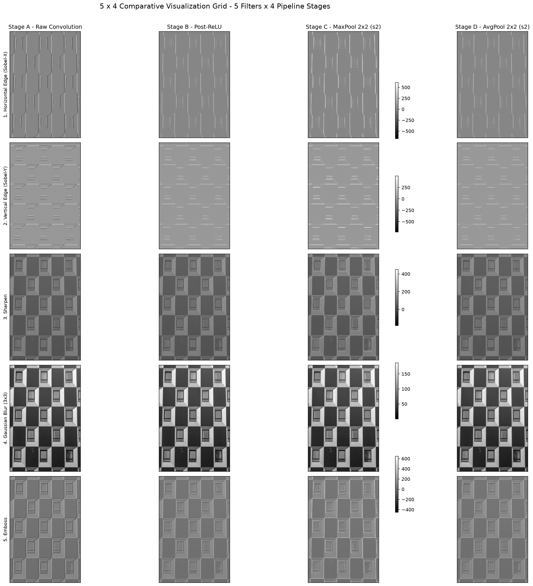

# CNN Feature Visualization, Parameter Audit & Critical Analysis

**Deep Learning & Computer Vision — Practical Laboratory Assignment**
*Evaluating Convolution Kernels, Non-Linear Activations, Pooling Operations, and Architectural Trade-offs*



---

## 📦 Deliverables:

| # | Rubric item (weight) | Deliverable | File in this repo |
|---|---|---|---|
| 1 | Visualization Grid & Code Execution **(20 %)** | Reproducible code + labeled **5 × 4 grid** (5 filters × Stages A–D) with consistent intensity scaling & colorbars | [`CNN_Visualization_Assignment.ipynb`](CNN_Visualization_Assignment.ipynb) → `results/fig1_5x4_feature_grid.png`, `results/stage_statistics.csv`, `results/input_grayscale.png` |
| 2 | Manual Parameter Audit **(25 %)** | Step-by-step **handwritten** calculations + framework `model.summary()` screenshot + audit table | [`HANDWRITTEN_CALCULATIONS.md`](HANDWRITTEN_CALCULATIONS.md) (copy this by hand) → `results/model_A_summary.png`, `results/model_B_summary.png`, `results/parameter_audit.csv`, `results/parameter_audit_detailed.csv` |
| 3 | Critical Analysis & Viva Defense **(55 %)** | Evidence-backed answers to Questions 1–5 grounded in *our own* grid | [`REPORT.md`](REPORT.md) (also embedded as the final section of the notebook) |

**Key verified numbers**

| Quantity | Value |
|---|---|
| Model A (3×3, MaxPool) trainable params — manual = code | **710 = 710** ✓ |
| Model B (5×5, AvgPool) trainable params — manual = code | **1750 = 1750** ✓ |
| Parameter increase A → B | **+146.48 %** (1040/710) |
| 3×3 layers needed to match one 5×5 receptive field | **2** (RF 3+2 = 5) |
| Parameters saved by stacking 3×3 (C = 10) | **690 = 27.49 % fewer** |
| ReLU zeroed pixels after convolution (Row 1 / Row 2) | **62.72 % / 57.99 %** |

---

## 🧪 What the pipeline does (Part I)

1. **Input** — a high-contrast architectural photograph (black/white checkerboard façade,
   [Pexels](https://www.pexels.com/photo/modern-hotel-facade-with-geometric-windows-29299050/),
   committed as `data/input_image.jpg`), converted to grayscale `[0, 255]`.
2. **Five custom 3×3 kernels** — Horizontal Edge (Sobel-X), Vertical Edge (Sobel-Y), Sharpen,
   Gaussian Blur (÷16), Emboss — applied **independently** with zero-padded `"same"` convolution
   (identical to `nn.Conv2d(k, padding=k//2)`).
3. **Four stages per filter**
   * **Stage A** — raw linear convolution
   * **Stage B** — `ReLU(x) = max(0, x)`
   * **Stage C** — Max Pool 2×2, stride 2 (on Stage B)
   * **Stage D** — Average Pool 2×2, stride 2 (on Stage B)
4. **5 × 4 grid** — rows = filters, columns = stages A–D. Each row shares **one** linear
   `vmin/vmax` derived from its own Stage A (the five kernels have wildly different dynamic
   ranges: blur ∈ [0, 255], Sobel ∈ ±1000), and the *same* mapping is used for B, C, D, so stages
   inside a row are directly comparable pixel-for-pixel. Every panel has a colorbar.

## 🏗 Part II — the two architectures

Both: `Input 32×32×3 → Conv → ReLU → Pool → Conv → ReLU → Pool → Global Average Pooling → Dense(10)`
(padding `'same'`, which does not affect parameter counts).

| Model | Kernels | Pooling | Manual count | Framework count |
|---|---|---|---|---|
| **A (Standard)** | 3×3 — 5 then 10 filters | Max Pool 2×2/s2 | 140 + 460 + 110 = **710** | **710** ✓ |
| **B (Large Kernel)** | 5×5 — 5 then 10 filters | Avg Pool 2×2/s2 | 380 + 1260 + 110 = **1750** | **1750** ✓ |

---

## ▶️ How to run (fresh clone)

```bash
git clone <your-repo-url>.git
cd <repo-folder>
pip install -r requirements.txt          # CPU-only torch is enough
jupyter notebook CNN_Visualization_Assignment.ipynb
# or regenerate everything headlessly:
jupyter nbconvert --to notebook --execute --inplace CNN_Visualization_Assignment.ipynb
```

Every figure and number in `results/` is regenerated by **Kernel → Restart & Run All**
(seed = 42). The framework summaries print inside the notebook and are also saved as
`.txt` and rendered `.png` (drop-in substitutes for a `model.summary()` screenshot — or
screenshot the notebook cell yourself).

---

## 📁 Repository structure

```
├── README.md                          ← this file
├── REPORT.md                          ← Part II audit + Part III answers Q1–Q5
├── HANDWRITTEN_CALCULATIONS.md        ← copy this onto your handwritten sheet (Part II)
├── CNN_Visualization_Assignment.ipynb ← full code + embedded answers (main deliverable)
├── requirements.txt
├── data/
│   └── input_image.jpg                ← selected input image (Pexels, free to use)
└── results/
    ├── fig1_5x4_feature_grid.png      ← Part I: the 5 × 4 grid
    ├── input_grayscale.png
    ├── stage_statistics.csv           ← per-stage min/max/mean + % zeros after ReLU
    ├── parameter_audit.csv            ← Part II: audit table (manual vs code)
    ├── parameter_audit_detailed.csv   ← per-layer breakdown
    ├── model_A_summary.txt / .png     ← framework summary (attach with handwritten sheet)
    └── model_B_summary.txt / .png
```

